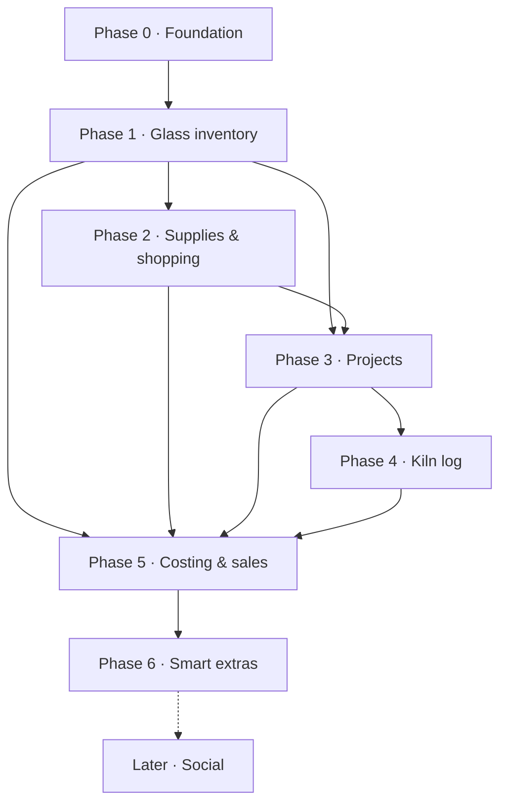

# Roadmap

Scope: stained and fused glass. Social features are parked for later.

Arrows mean "needs data from."

## Phase 0 · Foundation
- App shell with simple navigation: Inventory (Glass / Supplies), Shopping, Projects, Kiln
- Sign-in and cloud backup
- Photo storage for sheets, patterns and finished pieces
- Data model for glass, supplies, projects and firings
- Large text and big tap targets by default; phone and tablet first

## Phase 1 · Glass inventory (first release) — built
- Sheet glass: manufacturer, color name, product code, COE (90/96), type (cathedral, opalescent, streaky, wispy, iridized, textured), size on hand
- Frit, powder, stringers, noodles, confetti tracked by weight; dichroic by piece, with COE
- Scrap bin for offcuts by color and rough size
- Photo per sheet, plus a "how it looks fired" photo for fused glass
- Search and filter by color family, manufacturer, COE and type
- Barcode scanning: a known label opens its glass; a new one can be added or linked
- Sheets counted by size (3 × 12×12, 4 × 6×12) with per-size +/− and search by size

## Phase 2 · Supplies & shopping — built
- Stained: copper foil (by width), solder (60/40, 50/50, lead-free), lead came, flux, patina, grinder bits, cutter oil
- Fused: kiln wash, fiber paper, shelf paper, molds (dichroic is tracked as glass)
- Low-stock alerts with a per-item minimum
- Shopping list built from low stock and wish-list colors
- Cost per unit

## Phase 3 · Projects — built
- Project card: name, type (stained/fused), pattern image, progress photos
- Pull glass from inventory with automatic deduction
- COE compatibility warning for fused pieces
- Status: idea → cutting → foiling/assembling → firing → finishing → done

## Phase 4 · Kiln log
- Schedule library: full fuse, tack fuse, contour, slump, drape, fire polish
- Segments: rate (°F/hr), target temperature, hold time
- Firing log linked to a project, with before/after photos and notes
- Annealing guidance by thickness and COE
- Copy a past firing as a starting point

## Phase 5 · Costing & sales
- Cost per piece from glass, supplies and firings
- Pricing helper with her own markup
- Finished pieces: at home, on consignment, at a show, sold
- Sales log and monthly totals

## Phase 6 · Smart extras
- "What can I make with my scrap?" suggestions
- Find a color by photo
- Export to spreadsheet

## Later
- Social sharing, advice and community
- Destash marketplace
